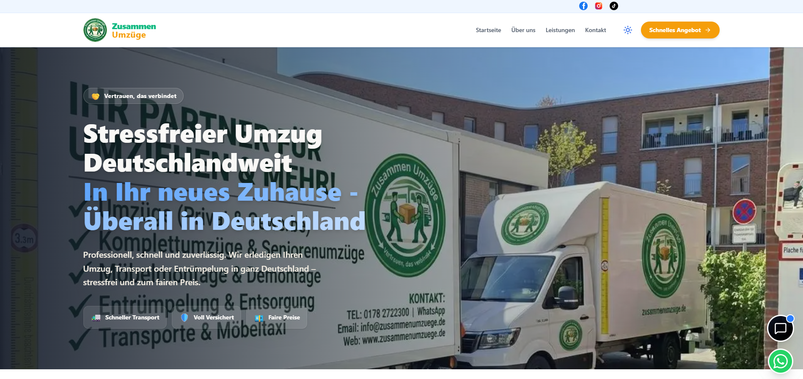

# 🚚 Zusammen Umzüge – Enterprise Logistics, AI Quoting & Invoicing Platform

[](https://zusammenumzuege.de/)
[](https://nextjs.org/)
[](https://react.dev/)
[](https://www.typescriptlang.org/)
[](https://tailwindcss.com/)
[](https://ai.google.dev/)
[](https://www.mongodb.com/)
[](https://github.com/parallax/jsPDF)
[](https://vitest.dev/)
[](https://www.docker.com/)

> **A mission-critical digital logistics and customer acquisition ecosystem for Zusammen Umzüge (Germany).** Engineered with Next.js 16, React 19, MongoDB, and Tailwind CSS v4, featuring a conversational Gemini AI booking assistant, algorithmic cubic-meter moving price calculators, DIN 5008 compliant PDF invoice & formal offer generation, address autocomplete, WhatsApp session bridging, and end-to-end testing with Vitest and Playwright.

---

## 📸 Preview



---

## 🌟 Key Features

- **🤖 Google Gemini AI Conversational Assistant (`Chatbot.tsx`):** Real-time intelligent virtual relocation advisor capable of answering customer inquiries, capturing structured leads, and estimating relocation requirements.
- **📑 Automated DIN 5008 PDF Invoice & Quotation Engines (`InvoiceGenerator.tsx`, `OfferGenerator.tsx`):** Enterprise-grade financial billing system generating legally compliant German invoices (Steuernummer, VAT/MwSt calculation, sequential numbering) with one-click direct PDF export (`jsPDF`, `html2canvas`) and print formatting.
- **📐 Algorithmic Moving Cost Estimation Engine (`pricing.ts`):** Dynamic multi-variable calculations factoring in total volume (m³), floor levels, elevator availability, hauling distance, packing supplies, and furniture assembly.
- **📍 Smart German Address Autocomplete (`AddressAutocomplete.tsx`):** Instant street, postal code, and city suggestions minimizing booking errors and validating routes.
- **💬 WhatsApp Business Dispatch Integration (`whatsapp.ts`):** Direct CRM customer communication bridge with automated session logging and quotation handoffs.
- **⚖️ Full Legal German Compliance:** Integrated cancellation forms (`WiderrufForm.tsx`), GDPR-ready privacy architecture, and structured terms.
- **✉️ Enterprise Multi-Provider Email Delivery:** Reliable transactional notification pipeline powered by **Resend** and **Nodemailer**.
- **🧪 High-Fidelity Automated QA:** Complete test suite covering unit math validations, in-memory MongoDB integrations (`mongodb-memory-server`), and cross-browser E2E testing with **Playwright**.
- **🐳 Dockerized Production Architecture:** Multi-stage `Dockerfile` ensuring parity between development and cloud production deployments.

---

## 🛠️ Tech Stack & Architecture

| Layer | Technology | Purpose |
| :--- | :--- | :--- |
| **Framework** | [Next.js 16 (App Router)](https://nextjs.org/) | Server-Side Rendering (SSR), Server Actions & API Route Handlers |
| **Frontend Library** | [React 19](https://react.dev/) | Concurrent UI rendering & modern component architecture |
| **Language** | [TypeScript 5](https://www.typescriptlang.org/) | Strict static typing across business rules, forms & models |
| **Styling** | [Tailwind CSS v4](https://tailwindcss.com/) | Modern high-performance utility styles & dynamic themes |
| **Artificial Intelligence**| [Google Generative AI (Gemini)](https://ai.google.dev/) | Context-aware relocation chatbot & customer query processing |
| **Database & ODM** | [MongoDB](https://www.mongodb.com/) & [Mongoose 9](https://mongoosejs.com/) | Persistent quote storage, invoice records & user accounts |
| **Document Generation** | [jsPDF](https://github.com/parallax/jsPDF) & [html2canvas](https://html2canvas.hertzen.com/) | Client-side and server-side PDF invoice generation |
| **Validation** | [Zod](https://zod.dev/) | Strict runtime schema parsing for forms and API requests |
| **Testing Suite** | [Vitest](https://vitest.dev/) & [Playwright](https://playwright.dev/) | Unit testing, integration safety & end-to-end browser workflows |
| **Containerization** | [Docker](https://www.docker.com/) | Reproducible multi-stage container build |

---

## ⚖️ Financial & Legal Engineering (German Standards)

1. **DIN 5008 Document Layouts:** Invoices and formal offers generated via `InvoiceGenerator.tsx` adhere strictly to German administrative design standards (sender line, recipient field, fold marks, tax breakdowns).
2. **Sequential Invoice Numbers (`invoice-number.ts`):** Automated, atomic invoice numbering ensuring accounting integrity.
3. **VAT / MwSt Compliance:** Dual gross/net calculation with 19% VAT calculations and explicit Steuernummer display.
4. **Widerrufsrecht Integration:** Interactive cancellation form (`WiderrufForm.tsx`) allowing customers to submit legally binding statutory revocation notices online.

---

## 🚀 Getting Started

### Prerequisites

- **Node.js** (v20.x or newer recommended)
- **MongoDB** instance (Local or Atlas)
- **npm**, **yarn**, or **pnpm**

### Environment Configuration

Create a `.env.local` file in the root directory:

```env
MONGODB_URI=mongodb+srv://<username>:<password>@cluster.mongodb.net/zusammen
GEMINI_API_KEY=your_gemini_api_key
RESEND_API_KEY=your_resend_api_key
JWT_SECRET=your_jwt_secret
NEXT_PUBLIC_SITE_URL=https://zusammenumzuege.de
```

### Installation & Run

1. **Clone the repository:**
   ```bash
   git clone https://github.com/Ploger1979/zusammen-umzuege-platform.git
   cd zusammen-umzuege-platform
   ```

2. **Install dependencies:**
   ```bash
   npm install
   ```

3. **Start local development server:**
   ```bash
   npm run dev
   ```

4. **Run Test Suites:**
   ```bash
   # Run Vitest Unit Tests
   npm run test:unit

   # Run Vitest Integration Tests
   npm run test:integration

   # Run Playwright End-to-End Tests
   npm run test:e2e
   ```

---

## 📦 Project Directory Structure

```plaintext
zusammen-umzuege-platform/
├── src/
│   ├── app/                  # Next.js 16 App Router (Localized pages & API routes)
│   ├── components/           # Reusable logistics UI components
│   │   ├── Chatbot.tsx       # Gemini AI customer relocation advisor
│   │   ├── InvoiceGenerator.tsx # Legal DIN 5008 PDF invoice engine
│   │   ├── OfferGenerator.tsx# Customer quotation generator
│   │   ├── QuoteFormFull.tsx # In-depth relocation estimation form
│   │   ├── AddressAutocomplete.tsx # German address autocomplete
│   │   └── WiderrufForm.tsx  # Statutory legal revocation form
│   ├── lib/                  # Business logic (pricing, mail, mongodb, rate-limit)
│   ├── models/               # Mongoose schemas (Invoice, Offer, Request, User)
│   └── messages/             # i18n translation dictionaries (de.json)
├── public/                   # Static branding, truck imagery & preview assets
├── playwright/               # Playwright browser configurations
├── tests/                    # End-to-end and integration test specifications
├── Dockerfile                # Production multi-stage container definition
├── vitest.config.ts          # Vitest testing configuration
└── tsconfig.json             # TypeScript compiler configuration
```

---

## 👨‍💻 Author

**Ayman Plöger**  
- Portfolio: [aymanbyte-portfolio.netlify.app](https://aymanbyte-portfolio.netlify.app/)  
- GitHub: [@Ploger1979](https://github.com/Ploger1979)  
- LinkedIn: [Ayman Plöger](https://www.linkedin.com/in/ayman-pl%C3%B6ger/)

---

## 📄 License

This project is proprietary and developed exclusively for **Zusammen Umzüge**.